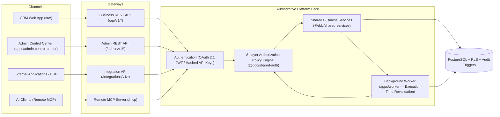

# DDC Agriculture CRM — Enterprise API Architecture

> **OpenAPI 3.1 Contract**: [`docs/openapi/v1.openapi.yaml`](./openapi/v1.openapi.yaml)  
> **Gateway Implementation**: `apps/api/src/platformRouter.ts`, `apps/api/src/router.ts`, `supabase/functions/api_v1/index.ts`  
> **Shared Business Services**: `packages/shared-services/`  
> **Centralized Authorization Engine**: `packages/shared-auth/`

---

## 1. Architectural Principle: Single Authoritative Business & Security Core

Every channel that interacts with DDC Agriculture CRM passes through the **exact same Shared Business Services, Centralized Authorization Policy Engine, input validators, and PostgreSQL Row-Level Security (RLS) policies**:

**Core invariants:**
1. **No Channel Bypass**: Remote MCP, Integration API, Admin API, and Background Workers never bypass business validation, RBAC, field-level PDPA masking, or PostgreSQL RLS.
2. **Zero Direct Database Access for AI or External Clients**: All data access flows through parameterized queries inside `withRlsTransaction()` (`packages/shared-services/src/sqlExecutor.ts`).
3. **Zero Unrestricted SQL**: Dynamic queries are compiled strictly from an allowlisted AST in `packages/shared-api/src/queryBuilder.ts` (`compileDynamicQuery`).

---

## 2. Versioned API Namespaces

| Namespace | Consumers | Auth Mechanism | Purpose & Isolation |
|---|---|---|---|
| `/api/v1/*` | CRM Web, Mobile Field Sales, Authenticated Users | Bearer JWT (Supabase Auth / OAuth 2.1) | Operational CRM endpoints: customers, contacts, agricultural machines, parts compatibility, price lists, opportunities, visits, follow-ups, quotations, analytics, saved queries, exports, jobs. |
| `/admin/v1/*` | Independent Admin Control Center (`dist-admin/`), Authorized Admins | Bearer JWT + `hasAdminConsoleAccess()` (`admin_console`, `users`, `roles`, `mcp_admin`, `mcp_approvals`, etc.) | Control plane & AI/MCP governance: overview, users, roles, permissions, audit logs, MCP tool registry, role/user policies, OAuth clients, connections, approvals, execution logs, security events. |
| `/integrations/v1/*` | External Systems, Automation Platforms, ERP Bridges | Scoped SHA-256 hashed Service Account API Key (`X-Api-Key` or `Authorization: ApiKey <key>`) or Bearer JWT | Scoped machine-to-machine CRM access obeying identical RBAC, organization isolation, field masking, rate limits, and `channel = 'integration_api'` auditing. |
| `/mcp` | Remote AI Clients | OAuth 2.1 + PKCE (`S256`) + RFC 9728 / RFC 8414 | Streamable HTTP (`2025-11-25`) Remote MCP server backed by 71 allowlisted tools. |

---

## 3. Cross-Cutting Platform Capabilities

### 3.1 Request Tracing & Channel Attribution
- Every request accepts or mints a validated `X-Request-Id` header (`req_...` or `mcp_...`), returned in both response headers and response envelopes.
- `withRlsTransaction()` sets transaction-local PostgreSQL GUCs before executing SQL:
  - `request.jwt.claim.sub` and `role = authenticated` (enforcing PostgreSQL RLS)
  - `app.request_id`, `app.channel` (`web`, `rest_api`, `mcp`, `integration_api`, `worker`, `system`), `app.ai_client_id`, `app.mcp_tool_name`, `app.approval_request_id`
  - `statement_timeout = '10s'` (query DoS guard)
- `public.ddc_audit()` automatically records these columns into `public.audit_log` while redacting secrets and oversized base64 blobs (`ddc_sanitize_audit_jsonb()`).

### 3.2 Idempotency & Duplicate Prevention
- `POST` creation endpoints and L1/L3 mutating MCP tools support `Idempotency-Key` (REST header) or `idempotency_key` (MCP argument).
- Keys are scoped per user, action, and canonical payload SHA-256 hash inside `public.idempotency_keys`:
  - Same key + identical payload hash → returns original result (`idempotentReplay: true`).
  - Same key + different payload hash → rejects with `409 DUPLICATE_REQUEST`.
- Customer creation additionally checks case-insensitive `(name, province)` uniqueness within the caller's organization (`409 DUPLICATE_REQUEST`).

### 3.3 Optimistic Concurrency Control
- Mutable CRM records (`companies`, `deals`, `customer_machines`, `quotations`) maintain an integer `version` column.
- `PATCH` routes accept `If-Match: "<version>"` or `expected_version` in the payload (and MCP update tools accept `expected_version`).
- Version mismatches abort with `409 VERSION_CONFLICT` without overwriting concurrent edits.

### 3.4 Rate Limiting
- `SlidingWindowRateLimiter` (`apps/api/src/rateLimiter.ts`) enforces per-principal, per-namespace limits:
  - `/api/v1/*`: 180 req/min (`query`: 60 req/min)
  - `/admin/v1/*`: 60 req/min
  - `/integrations/v1/*`: 180 req/min
- Responses include `X-RateLimit-Limit`, `X-RateLimit-Remaining`, and `Retry-After` on `429 RATE_LIMIT_EXCEEDED`.

### 3.5 Standardized Error Envelope
All API and MCP layers share the 15 canonical `PlatformErrorCode` values defined in `packages/shared-auth/src/errors.ts`:

| Code | HTTP Status | Meaning |
|---|---|---|
| `AUTHENTICATION_REQUIRED` | `401` | Missing, malformed, revoked, or unverifiable credential |
| `TOKEN_EXPIRED` | `401` | Access token `exp` has passed |
| `ACCOUNT_SUSPENDED` | `403` | `sales.disabled = true` (checked live in DB) |
| `MCP_ACCESS_DISABLED` | `403` | Organization, role, user, client, or connection MCP access disabled/revoked |
| `TOOL_DISABLED` | `403` | Registered MCP tool is dynamically disabled in Tool Registry |
| `PERMISSION_DENIED` | `403` | Missing authoritative CRM RBAC grant, OAuth scope, explicit DENY override, or forbidden action |
| `DATA_SCOPE_DENIED` | `403` | Cross-organization or out-of-scope record access (`own`/`team`/`territory`) |
| `FIELD_ACCESS_DENIED` | `403` | Attempted write to un-allowlisted, hidden, masked, or read-only field |
| `CONFIRMATION_REQUIRED` | `428` | L3 operation requires valid payload-bound confirmation token from preview/validation |
| `APPROVAL_REQUIRED` | `403` | L4/L5 operation requires independent human approval (or payload/version changed after approval) |
| `VALIDATION_FAILED` | `400` | Input schema or business rule validation failure |
| `VERSION_CONFLICT` | `409` | Optimistic concurrency `version` mismatch |
| `DUPLICATE_REQUEST` | `409` | Duplicate entity or idempotency key reused with conflicting payload |
| `RATE_LIMIT_EXCEEDED` | `429` | Per-user, per-tool, or per-client rate limit exceeded |
| `RESOURCE_NOT_AVAILABLE` | `404` / `504` | Record not found (or hidden by RLS), route missing, or execution timeout |

---

## 4. Backward Compatibility

- Existing CRM web application data provider (`src/components/atomic-crm/providers/supabase/`) continues functioning unchanged against Supabase PostgREST + RLS.
- Existing `createApiV1Handler` (`apps/api/src/router.ts`) and `supabase/functions/api_v1/index.ts` health/query/config routes remain preserved alongside `createEnterpriseApiHandler` (`apps/api/src/platformRouter.ts`).
- All database additions in `supabase/migrations/20261127150000_ddc_mcp_platform.sql` are strictly additive (expand-and-contract) with safe defaults (`organization_id = 1`, `channel = 'web'`).
