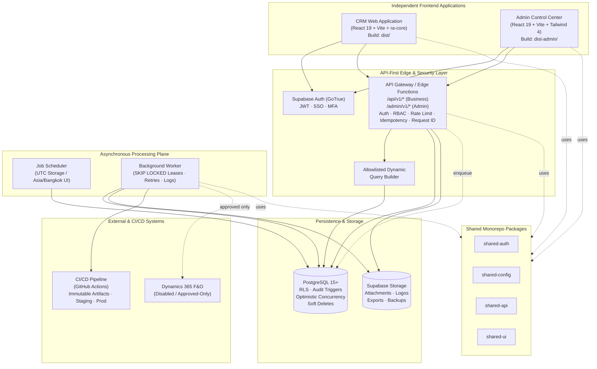

# DDC Agriculture CRM — Enterprise Architecture

> **Status**: Phase 1 Foundation Active | **Last Updated**: 2026-11-27

## 1. Architectural Style

DDC Agriculture CRM follows a **Modular Monolith inside a single Git Monorepo** (`ddc-crm/`) with **API-First boundaries** and **independently buildable and deployable applications**:

1. **CRM Web Application** (`src/`, `demo/` → `dist/`): Sales, Field Visits, Customer 360, Agriculture Machines & Parts, RFQs, Quotations, Projects, Service Cases.
2. **Admin Control Center** (`apps/admin-control-center/` → `dist-admin/`): Independent enterprise control plane (15 modules) for identity, RBAC, data governance, query builder, API keys, Web Design Studio, feature flags, releases, deployments, jobs, backups, and settings.
3. **Backend API Gateway** (`apps/api/` + `supabase/functions/api_v1/`): Versioned REST API separating Business APIs (`/api/v1/*`) and Administrative APIs (`/admin/v1/*`), enforcing server-side RBAC, Zod validation, allowlisted Dynamic Query Builder, rate limiting, idempotency, and request correlation (`X-Request-Id`).
4. **Background Worker & Job Scheduler** (`apps/worker/`): Durable asynchronous processor for scheduled deployments, scheduled config publishing, scheduled feature flags, imports/exports, reports, notifications, ERP synchronization, and backup orchestration.
5. **Shared Packages** (`packages/`):
   - `packages/shared-auth`: Roles, permissions, data scopes, field-level permissions, secret redaction.
   - `packages/shared-config`: Typed UI configuration schema, anti-XSS sanitizer, publish lifecycle state machine, deterministic feature flag evaluator.
   - `packages/shared-api`: Versioned envelopes, error codes, allowlisted Dynamic Query Builder AST & validator, OpenAPI 3.1 contract.
   - `packages/shared-ui`: Shared design tokens, formatting utilities (`Asia/Bangkok` timestamps, currency), accessible enterprise primitives.
6. **PostgreSQL + Supabase Platform** (`supabase/`): Normalized relational database with Row Level Security (RLS), append-only audit triggers, workflow state-machine RPCs, storage buckets, and GoTrue Auth.

---

## 2. System Architecture Diagram



---

## 3. Repository & Monorepo Layout (`ddc-crm/`)

```text
ddc-crm/
├── src/                          # Existing CRM Web Application (preserved)
│   ├── components/               # Atomic CRM + shadcn/ui + shadcn-admin-kit
│   └── ddc/                      # DDC Agriculture domain, field sales, resources, providers
├── demo/                         # Local evaluation mode entrypoint (FakeRest + IndexedDB)
├── apps/
│   ├── admin-control-center/     # Independent Admin Control Center SPA (port 5179, dist-admin/)
│   ├── api/                      # Versioned API router, middleware, query execution engine
│   └── worker/                   # Durable background job runner, scheduler & lease manager
├── packages/
│   ├── shared-auth/              # RBAC, data scopes, field permissions, redaction
│   ├── shared-config/            # Typed UI config schema, lifecycle, feature flag evaluator
│   ├── shared-api/               # Envelopes, OpenAPI types, allowlisted Dynamic Query Builder
│   └── shared-ui/                # Shared tokens, Asia/Bangkok timezone & enterprise UI helpers
├── supabase/
│   ├── schemas/                  # Upstream Atomic CRM declarative base schema
│   ├── migrations/               # Ordered backward-compatible SQL migrations
│   ├── functions/                # Deno Edge Functions (api_v1, users, erp_sync, merge_contacts, ...)
│   └── tests/                    # PGlite PostgreSQL schema, RLS, security & workflow tests
├── docs/                         # Synchronized enterprise documentation + OpenAPI 3.1 spec
├── e2e/                          # Playwright end-to-end tests
├── vite.config.ts                # CRM Web build -> dist/
├── vite.demo.config.ts           # CRM Demo build -> dist/
└── vite.admin.config.ts          # Admin Control Center build -> dist-admin/
```

---

## 4. Independent Build & Deployment Isolation

| Artifact | Entrypoint | Build Command | Output | Target URL Pattern |
|---|---|---|---|---|
| **CRM Web App** | `index.html` / `src/main.tsx` | `npm run build` | `dist/` | `crm.ddc.internal` |
| **Admin Control Center** | `apps/admin-control-center/index.html` | `npm run build:admin` | `dist-admin/` | `admin.ddc.internal` |
| **Backend API (`api_v1`)** | `supabase/functions/api_v1/index.ts` | `supabase functions deploy api_v1` | Edge bundle | `api.ddc.internal/functions/v1/api_v1` |
| **Background Worker** | `apps/worker/src/index.ts` | `npm run typecheck:enterprise` | Node 24 container/process | Private worker network (no public ingress) |

### Workload Isolation Principles
- Admin analytical queries, bulk imports/exports, and reports execute asynchronously via `scheduled_jobs` in the Background Worker rather than blocking interactive CRM users.
- Query limits (`maxPageSize = 100`, max query timeout `10s` on interactive endpoints) and dedicated worker connection pool ceilings protect the primary PostgreSQL instance.
- Read replicas are deferred until measured CPU/IOPS telemetry justifies replication lag complexity.

---

## 5. Key Architecture Decisions

See [DEVELOPMENT_ROADMAP.md](./DEVELOPMENT_ROADMAP.md#3-architecture-decision-records-adrs) for full ADR rationales (`ADR-001` through `ADR-007`).
