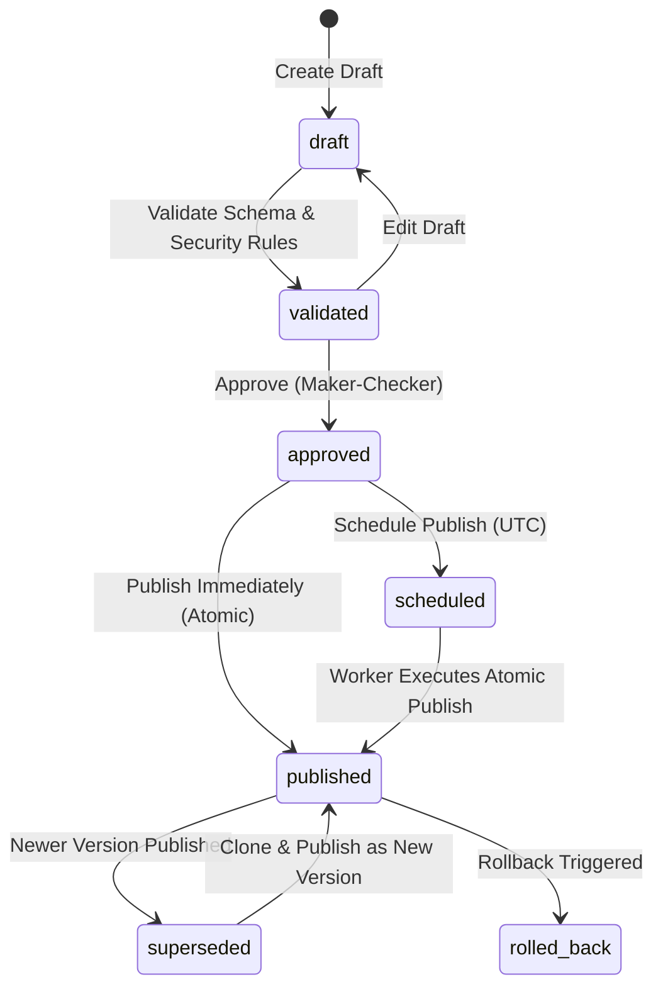

# DDC Agriculture CRM — Configuration-Driven UI & Feature Flag Management

> **Shared Schema & State Machine**: `packages/shared-config/`
> **Persistence Tables**: `public.ui_config_versions`, `public.feature_flags`, `public.feature_flag_history`

---

## 1. Typed UI Configuration Schema (`packages/shared-config/src/uiConfigSchema.ts`)

Supported runtime-configurable domains (zero code deployment required once published):

1. **Branding**: application title, short subtitle, footer text, support email/phone.
2. **Logos**: light-mode logo URL/asset ref, dark-mode logo URL/asset ref, favicon URL.
3. **Theme Colors**: validated hex tokens (`#RRGGBB`) for `primary`, `secondary`, `accent`, `surface`, `danger`, `warning`, `success`.
4. **Typography**: allowlisted font family tokens (`IBM Plex Sans Thai`, `Inter`, `Sarabun`, `Prompt`, `Noto Sans Thai`) and base scale (`compact` | `default` | `comfortable`).
5. **Login Background**: validated image asset URL or preset gradient token + headline/tagline text.
6. **Navigation Configuration**: ordered groups and visibility toggles for allowlisted route keys (never overrides server-side RBAC).
7. **Dashboard Widgets**: ordered widget catalog IDs, visibility, grid span (`1`–`4`), and default filter presets.
8. **Table Column Visibility**: per-resource column order, visibility, label override, and pixel width bounds (`48`–`1600`).
9. **Supported Dynamic Form Fields**: typed field definitions (`text`, `number`, `date`, `boolean`, `select`), labels (`th`/`en`), required flag, options list, section placement.
10. **Notification Templates**: plain-text / Mustache-style `{{variable}}` templates (subject + body, Thai & English) for allowlisted event keys (e.g. `quotation.approval_requested`, `release.deployed`, `followup.overdue`).

---

## 2. Configuration Lifecycle & Atomic Publishing

### Lifecycle Rules
1. **Draft**: Editable JSON stored in `ui_config_versions (status = 'draft')`.
2. **Validate**: Runs Zod schema + security sanitizer (`validateUiConfigPayload`) and stores `validation_errors` and SHA-256 `checksum`. Cannot advance if errors exist.
3. **Preview**: Admin Control Center passes draft payload to CRM preview frame / query param in read-only isolated mode (`Preview` does not alter active production config).
4. **Approve**: Authorized approver (`ui_config:approve`) marks `status = 'approved'` (records `approved_by_sales_id`, `approved_at`).
5. **Publish (Atomic)**: PostgreSQL RPC `publish_ui_config_version(p_version_id)` runs inside a single transaction with row lock:
   - Demotes current `published` row for the target `environment` to `superseded`.
   - Promotes target `approved`/`scheduled` row to `published` and stamps `published_at = now()`.
   - Partial unique index `ui_config_versions_one_published_per_env` guarantees there is **never** more than one active published configuration per environment.
6. **Rollback**: `rollback_ui_config_version(p_target_version_id)` atomically creates/promotes a rollback version referencing `rolled_back_from_id` and immediately restores the prior validated payload.

---

## 3. Anti-Injection Security Controls

Configuration payloads are **strictly declarative data**:
- No raw `<script>`, `<iframe>`, `<svg>`, `<object>`, or inline `on*=` attributes permitted anywhere in strings.
- URLs must match `^https://` or relative `^/[a-zA-Z0-9/_.-]+$` (or safe raster `data:image/(png|jpeg|webp);base64,` with size cap). `javascript:`, `vbscript:`, and `data:text/html` are unconditionally rejected.
- CSS values accept only strict hex color tokens (`^#[0-9a-fA-F]{6}$`) and enumerated font/density keys — never arbitrary CSS blocks.
- Notification templates use variable interpolation only (`{{var}}`), escaped before rendering.

---

## 4. Runtime Feature Flag System (`packages/shared-config/src/featureFlags.ts`)

Each flag in `public.feature_flags` supports:
- `is_enabled` (boolean global toggle)
- `kill_switch` (boolean emergency override — when `true`, flag **immediately evaluates `false`** regardless of targeting or schedule)
- `target_user_ids` (explicit `sales.id` allowlist)
- `target_role_keys` (explicit `ddc_roles.key` allowlist)
- `target_team_ids` (explicit `teams.id` allowlist)
- `rollout_percentage` (`0`–`100`, deterministic FNV-1a hash of `flag_key:user_id` so a user never flickers across sessions)
- `scheduled_enable_at` / `scheduled_disable_at` (UTC timestamps; displayed in `Asia/Bangkok`)
- `feature_flag_history` + `audit_log` (immutable audit trail of every toggle)

### Precedence Order
1. `kill_switch === true` → **`false`** (emergency stop)
2. `is_enabled === false` → **`false`**
3. Outside `[scheduled_enable_at, scheduled_disable_at]` window → **`false`**
4. `userId ∈ target_user_ids` → **`true`**
5. `roleKey ∈ target_role_keys` → **`true`**
6. `any(teamId ∈ target_team_ids)` → **`true`**
7. `rollout_percentage > 0 && stableBucket(flag_key, userId) < rollout_percentage` → **`true`**
8. Default → **`false`**

> **Security Rule**: Feature flags control product rollout and UI exposure ONLY. They **never** substitute for server-side RBAC or PostgreSQL RLS.
