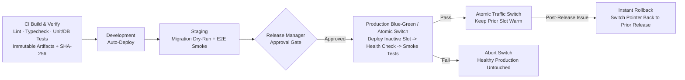

# DDC Agriculture CRM — Deployment Runbook & Release Management

> **Environments**: `development` → `staging` → `production`
> **Artifacts**: Independently built immutable bundles (`dist/` for CRM Web, `dist-admin/` for Admin Control Center, Supabase Edge Functions, Node Worker image, SQL migrations).

---

## 1. Release & Deployment Strategy

For the Windows LAN test host, see [LAN Demo accounts](LAN_DEMO_ACCOUNTS.md).

### Key Guarantees & Honest Limitations
- **Immutable Release Artifacts**: Production NEVER rebuilds from `main`. Production deploys the exact tested, checksum-verified artifact built for Staging (`releases.artifact_uri` + `releases.artifact_checksum`).
- **Atomic Switch / Blue-Green**: The new CRM and Admin static releases are uploaded to an isolated versioned prefix/slot and validated via health checks & smoke tests **before** switching the live routing pointer. The previous healthy release stays intact until post-switch verification succeeds.
- **No Unverified Zero-Downtime Promise**: Zero-downtime deployment is **not guaranteed** until (a) the hosting provider's atomic switchover is configured and verified in staging, and (b) every database migration in the release is verified backward-compatible with the currently active application version.
- **Secrets Isolation**: Deployment tokens (`SUPABASE_ACCESS_TOKEN`, `SUPABASE_DB_PASSWORD`, hosting API tokens) live ONLY in GitHub Actions Environment Secrets or server secret vaults — NEVER in `VITE_*` variables or client bundles.

---

## 2. Expand-and-Contract Database Migration Policy

1. **Expand (Release N)**:
   - Add new tables, nullable columns, defaulted columns, or new views/functions.
   - Ensure active application version `N-1` continues running without errors against schema `N`.
   - Test with `npm run test:db` (PGlite) AND against Staging PostgreSQL.
2. **Migrate & Verify (Release N)**:
   - Backfill data via idempotent background job if needed.
   - Switch application code to read/write the new structure.
3. **Contract (Release N+1, only after explicit approval & backup)**:
   - Remove deprecated columns/tables only after verifying zero active references and taking a verified `pre_migration` backup.

---

## 3. Standard Deployment Procedure

### Pre-Flight Checklist
- [ ] CI `check.yml` green: `lint`, `typecheck`, `typecheck:enterprise`, `test:db`, `test:unit:functions`, `test:enterprise`, `build`, `build:admin`.
- [ ] Release record created in `public.releases` with `git_sha`, `artifact_checksum`, and `build_status = 'succeeded'`.
- [ ] Staging deployment succeeded, health checks passed, and smoke tests passed.
- [ ] Pre-migration backup recorded in `public.backup_records` (if release includes SQL migrations).
- [ ] `Release Manager` or `Super Admin` approval recorded (`releases.approval_status = 'approved'`).

### Execution Steps (Staging / Production)
1. **Database Migrations** (backward-compatible only):
   - Apply `npx supabase db push` using CI/CD runner with environment-scoped secrets.
   - Verify migration history and run read-only schema health check.
2. **Backend API & Edge Functions**:
   - Deploy versioned Edge Functions (`api_v1`, `users`, `merge_contacts`, `erp_sync`, etc.).
   - Verify `GET /api/v1/health` returns `200 OK` with expected `version` and `gitSha`.
3. **Frontend Applications (Independent)**:
   - Deploy `dist/` (CRM Web) to inactive slot / versioned prefix.
   - Deploy `dist-admin/` (Admin Control Center) to inactive slot / versioned prefix.
4. **Validation Before Cutover**:
   - Run automated health checks (HTTP 200, CSP/HSTS headers, asset integrity).
   - Run smoke tests (login, `/api/v1/me`, list customers, admin overview auth guard `403` for non-admin).
5. **Atomic Cutover & Notification**:
   - Switch production pointer to validated release.
   - Record `deployments.status = 'succeeded'` and send release notification.

---

## 4. Rollback Procedure

1. **Frontend / API Failure**:
   - Trigger Rollback from Admin Control Center → Deployment Scheduler (or CI workflow dispatch) pointing to `deployments.previous_deployment_id`.
   - Routing pointer atomically reverts to the previous immutable release artifact.
   - Verify health checks & smoke tests against restored release.
2. **UI Configuration Issue (No Code Deploy Needed)**:
   - Roll back via Admin Control Center → Web Design Studio → Version History (`rollback_ui_config_version`).
3. **Feature Regression**:
   - Activate Emergency Kill Switch in Admin Control Center → Feature Flag Management.
4. **Database Issue**:
   - Because all migrations are additive (expand-only), reverting application code leaves the database compatible. Never run destructive `DROP` scripts during an incident; escalate to PITR restore per [BACKUP_RECOVERY.md](./BACKUP_RECOVERY.md) only with explicit executive approval.
