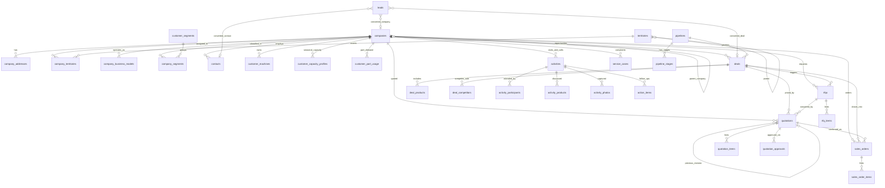
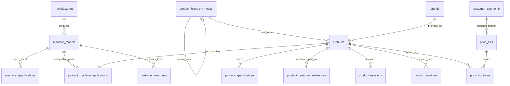
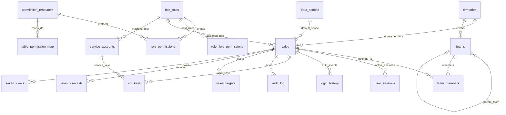
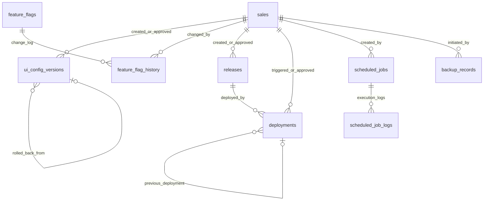

# DDC Agriculture CRM — Entity-Relationship Diagrams (ERD)

> Synchronized with `supabase/schemas/` + `supabase/migrations/*_ddc_*.sql` (including Phase 1 `20261127140000_ddc_enterprise_foundation.sql`).

## 1. Customer Master, Sales Pipeline & Field Operations

---

## 2. Agriculture Machinery, Products & Pricing

---

## 3. Users, RBAC, Teams, Data Scopes & Security Audit

---

## 4. Enterprise Admin Control Plane (Config, Feature Flags, Releases & Jobs)

