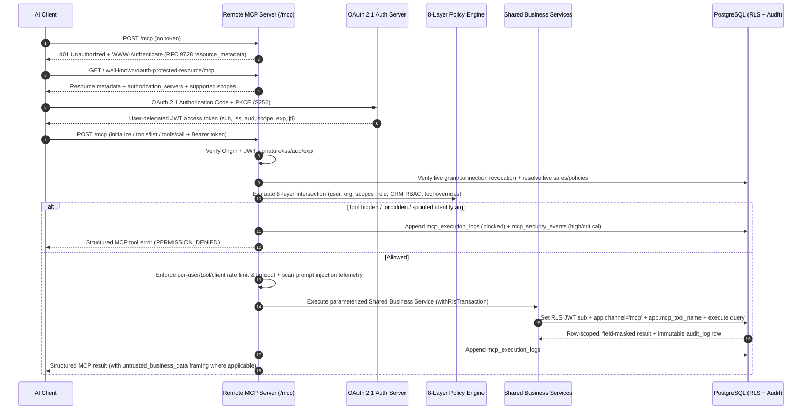

# DDC Agriculture CRM — Remote MCP Server Architecture

> **SDK & Protocol**: Official `@modelcontextprotocol/server@2.4.0` · Streamable HTTP (`2025-11-25`, backwards-compatible with `2025-06-18`, `2025-03-26`, `2024-11-05`, `2024-10-07`)  
> **Standalone Server**: `apps/mcp/src/mcpServer.ts`, `apps/mcp/src/nodeServer.ts`  
> **Edge Function Runtime**: `supabase/functions/mcp/index.ts` (SEC-04 remediated — zero raw SQL)  
> **Tool Registry**: `apps/mcp/src/toolRegistry.ts` (**71 allowlisted operational tools across 13 business domains**)

---

## 1. End-to-End Remote MCP Request Pipeline

---

## 2. Deployment Topologies

DDC supports two production-oriented MCP deployment runtimes backed by the same PostgreSQL database and governance tables:

1. **Independently Deployable Standalone Remote MCP Server (`apps/mcp/`)**:
   - Exposes `POST/GET/DELETE /mcp`, `GET /health`, `GET /.well-known/oauth-protected-resource/mcp`, `GET /.well-known/oauth-protected-resource`, and `GET /.well-known/oauth-authorization-server`.
   - Hosts the complete **71-tool Registry**, all **6 permission-controlled Resources**, all **7 permission-controlled Prompts**, live `AuthorizationPolicyCache`, per-tool/per-client sliding-window rate limiting, and `notify.toolsChanged()` stream notifications.
   - Started via `apps/mcp/src/nodeServer.ts` behind TLS termination (HTTPS mandatory in production).
2. **Hardened Supabase Edge Function (`supabase/functions/mcp/index.ts`)**:
   - Permanently replaces the legacy upstream Atomic CRM raw-SQL endpoint (`get_schema`, `query`, `mutate` **removed**, remediating SEC-04).
   - Uses `@modelcontextprotocol/server@2.4.0` + `withOAuthProtectedResource()` + `withSupabase({ auth: "user" })` + parameterized RLS queries (`rlsPostgres.ts`) + live DB policy checks (`sales.disabled`, `organizations.mcp_enabled`, `mcp_role_policies`, `mcp_user_policies`, `mcp_tool_permissions`) + `mcp_execution_logs`.
   - Verified by static regression tests in `supabase/functions/mcp/mcpSecurity.test.ts`.

---

## 3. Dynamic Per-User Capability Scoping

A fresh, principal-scoped `McpServer` instance is built per authenticated request via `createMcpHandler`:

- **Tools (`tools/list`)**: Only tools passing `evaluateMcpToolAuthorization(principal, effectiveSubject, bundle)` are registered on the scoped server. Unauthorized, disabled, risk-capped, or explicitly denied tools are completely hidden from discovery.
- **Direct Hidden-Tool Guard (`tools/call`)**: Even if an AI client caches an older tool list or manually fabricates a `tools/call` for a hidden tool or a forbidden generic tool (`execute_sql`, `query`, `mutate`, `get_schema`, `execute_shell`, `unrestricted_http_request`, `unrestricted_admin_action`), the pre-dispatch security gate blocks execution, writes both `mcp_execution_logs` and `mcp_security_events`, and returns a structured `PERMISSION_DENIED` / `TOOL_DISABLED` error.
- **Spoofed Identity Argument Guard**: Every tool input schema uses Zod `.strict()`, and the pre-dispatch gate explicitly rejects `user_id`, `role`, `organization_id`, `administrator`, `permissions` (and `role_key` on non-admin-role tools), logging a `critical` `privilege_escalation` event.
- **Live Re-Evaluation & Cache Invalidation**: Every policy edit through `McpGovernanceService` increments `organizations.policy_version`, invalidates `AuthorizationPolicyCache`, and fires `mcpHandler.notify.toolsChanged()` so active MCP clients refresh tool lists immediately without redeployment.

---

## 4. Permission-Controlled MCP Resources & Prompt Templates

### Resources (6 registered conditionally per caller's RBAC)
| Resource Name | URI / Template | Required Permission | Content |
|---|---|---|---|
| `product-catalog` | `ddc://catalog/products` | `products:read` | Permission-filtered DDC agricultural spare parts catalog |
| `customer-summary` | `ddc://customers/{customerId}/summary` | `customers:read` | Field-masked Customer 360 profile & contacts |
| `machine-specs` | `ddc://machines/{machineModelId}/specs` | `machine_applications:read` | Verified agricultural machine specifications & fitment parts |
| `sales-summary-report` | `ddc://reports/sales-summary` | `reports:read` + `opportunities:read` | Aggregated pipeline & quotation summary |
| `business-data-dictionary` | `ddc://metadata/data-dictionary` | Authenticated MCP user | Safe business vocabulary (5 customer groups, product families, L0–L5 risk definitions; **never internal DB schemas or secrets**) |
| `user-workflow-guide` | `ddc://me/workflow-guide` | Authenticated MCP user | Guidance strictly tailored to the caller's authorized tools and risk ceiling |

### Prompt Templates (7 registered only if caller can use the backing tool)
| Prompt Name | Backing Tool Requirement | Workflow Guided |
|---|---|---|
| `customer_visit_report` | `create_visit_report` | Field visit logging + follow-up capture |
| `customer_data_entry` | `create_customer` | Duplicate-checked new customer entry |
| `machine_registration` | `register_machine` | Customer machine fleet registration (never inventing serials) |
| `sales_opportunity_creation` | `create_opportunity` | Customer-linked deal creation |
| `quotation_preparation` | `create_quotation` | Verified fitment lookup + official pricing + draft quotation |
| `weekly_sales_report` | `query_sales_summary` | Weekly pipeline, quotation, and visit briefing |
| `replacement_demand_analysis` | `query_replacement_demand` | Seasonal wear-part replacement forecasting |
